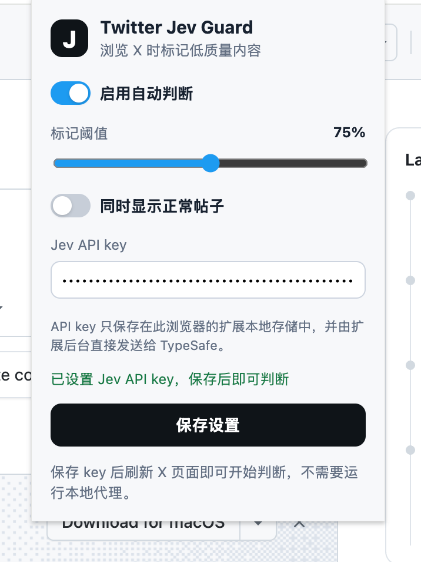
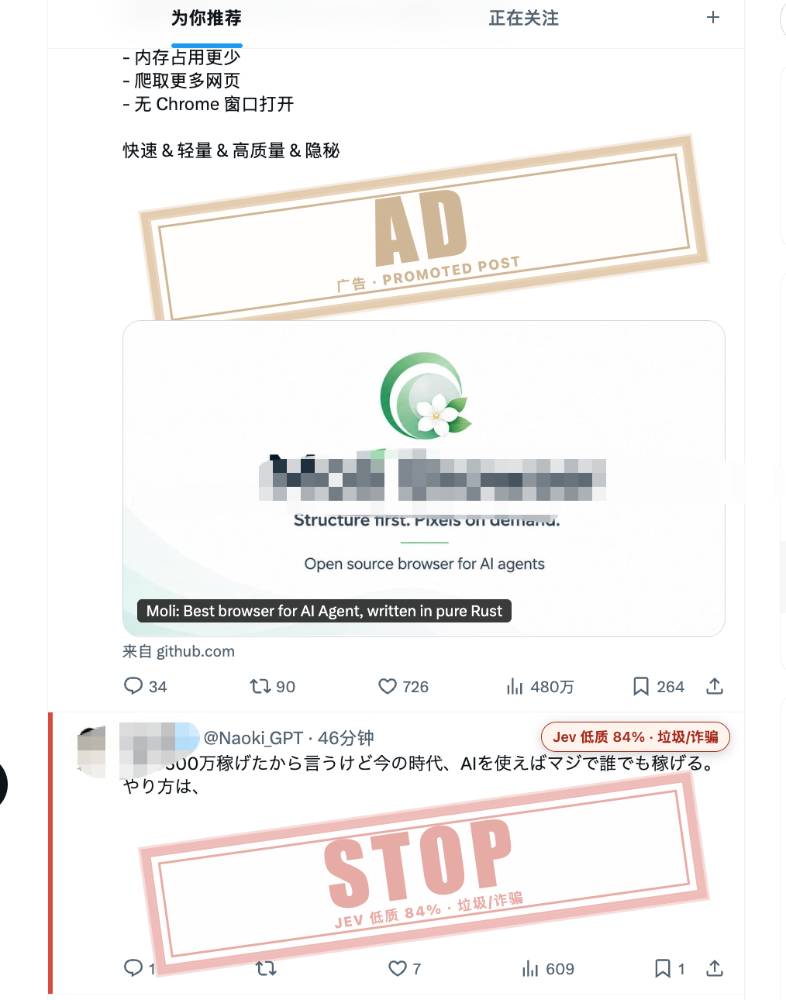

# Twitter Jev Guard

使用 [TypeSafe Jev](https://typesafe.ai/) 在 X/Twitter 时间线上识别低质量、垃圾和推广帖子，并在帖子文字区域显示醒目的半透明水印。

Twitter Jev Guard 是一个 Chrome/Edge Manifest V3 浏览器扩展，面向个人浏览辅助。它帮助你快速注意到疑似垃圾、诱导互动、重复搬运和广告内容，不是事实核查工具，也不是平台审核系统。

## 效果预览

扩展设置面板：

<p>
  
</p>

时间线中的水印：

<p>
  
</p>

## 功能

- 扩展后台直接调用 TypeSafe Jev，不需要运行本地代理。
- 在扩展弹窗中填写和保存 Jev API key。
- 使用低质量概率阈值判断，默认阈值为 75%。
- 低质量帖子显示红色半透明 `STOP` 大水印和概率标签。
- X 标记为广告或推广的帖子显示琥珀色半透明 `AD / 广告` 大水印。
- 水印放在帖子文字区域，不覆盖图片或视频。
- 继续滚动时间线时自动扫描新帖子，并限制并发请求数量。
- 支持 `x.com` 和 `twitter.com`。

## 快速开始

### 1. 准备 Jev API key

准备一个可用的 TypeSafe API key。不要把真实 key 写进代码、README、截图或 Git 提交记录。

### 2. 加载扩展

1. 打开 Chrome 的 `chrome://extensions`，或 Edge 的 `edge://extensions`。
2. 开启“开发者模式”。
3. 点击“加载已解压的扩展程序”。
4. 选择本项目根目录，也就是包含根部 `manifest.json` 的 `twitter-jev-guard` 目录。

   如果项目位于其他位置，选择复制后的项目根目录即可。不要选择 `server` 文件夹。

### 3. 设置 API key

点击浏览器工具栏中的 Twitter Jev Guard 图标，在 `Jev API key` 输入框中填写 key，点击“保存设置”，然后刷新 X 页面。

扩展通过 `chrome.storage.local` 保存设置，默认配置如下：

| 设置 | 默认值 | 作用 |
| --- | --- | --- |
| 自动判断 | 开启 | 自动扫描可见帖子 |
| 标记阈值 | 75% | 低质量概率达到此值时显示 `STOP` |
| 显示正常帖子 | 关闭 | 开启后也显示绿色正常标签 |

## 水印规则

Jev 会同时回答两个问题：

1. 这条帖子是否值得在个人时间线上提醒为低质量内容。
2. 帖子的主要类型是什么，例如垃圾/诈骗、推广、诱导互动、疑似误导或有价值内容。

当低质量概率达到阈值时，水印会放在 `tweetText` 的文字容器内，使用红色半透明旋转印章显示 `STOP`。X 的 DOM 中出现 `广告`、`推广`、`Promoted` 或 `Sponsored` 等推广标识时，扩展会在文字区域显示琥珀色 `AD / 广告` 水印。广告识别只检查帖子元数据，不会因为正文里提到“广告”就直接判为广告。

同一条帖子在当前页面会话中不会重复请求；滚动或页面结构变化时会继续处理新出现的帖子。

## 工作原理

```text
X/Twitter 时间线
        |
        v
内容脚本读取可见帖子文字和元数据
        |
        v
扩展后台 service worker 直连 TypeSafe Jev
        |
        v
返回低质量概率 + 内容类型
        |
        v
文字区域显示 STOP 或 AD 半透明水印
```

请求使用 `POST https://api.typesafe.ai/v1/systemone` 和 `jev-latest` 模型。扩展会在遇到 `429`、`529` 或服务器错误时进行有限重试。

## 隐私与安全

- 帖子文本和少量公开元数据会发送给 TypeSafe，用于 Jev 判断。
- 当前版本不上传图片或视频，也不会读取私信内容作为判断输入。
- API key 保存在浏览器扩展的本地存储中。浏览器扩展属于客户端代码，拥有本机权限的用户或其他扩展理论上可以访问它；如果需要更强的密钥隔离，应改用自建服务端代理。
- 建议为个人使用单独创建 key，并设置额度或定期轮换。不要把 key 提交到 GitHub。

## 开发与检查

项目没有第三方运行时依赖，Node.js 20 只用于语法检查和可选的旧代理代码：

```bash
npm run check
```

主要文件：

```text
manifest.json             # 推荐加载的根目录清单
extension/background.js   # 直连 Jev 的 service worker
extension/content.js      # X DOM 扫描、广告识别和水印渲染
extension/content.css     # 标签和半透明水印样式
extension/popup.html/js   # 设置面板
extension/popup.css       # 设置面板样式
extension/manifest.json   # 兼容直接加载 extension 子目录
assets/                   # README 展示截图
```

仓库中还保留了 `server/`、`.env.example` 和 `start.command` 作为早期本地代理实验代码。当前扩展的正常使用路径不需要启动它们。

## 排查

- **扩展无法加载清单**：确认选择的是包含根部 `manifest.json` 的 `twitter-jev-guard` 目录。
- **显示“Jev 请求失败”**：打开扩展弹窗，确认 API key 已填写并点击“保存设置”，然后刷新 X 页面。
- **没有出现水印**：确认当前网址是 `x.com` 或 `twitter.com`，刷新页面，并检查扩展是否仍处于启用状态。
- **广告没有被识别**：广告水印依赖 X 当前页面提供的推广标识；X 修改 DOM 或标签语言后，识别规则可能需要更新。

## 已知限制

Jev 返回的是概率判断，结果会受语言、上下文和 X 页面结构影响。当前版本主要分析文字和公开元数据，不做图像内容理解、视频内容理解或事实真伪验证。使用前请根据自己的内容偏好调整阈值。

## License

当前仓库尚未指定开源许可证。公开发布前，请根据你的使用场景补充合适的 LICENSE 文件。
